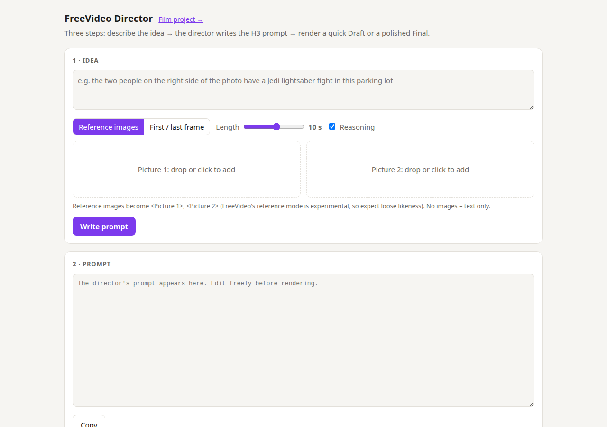
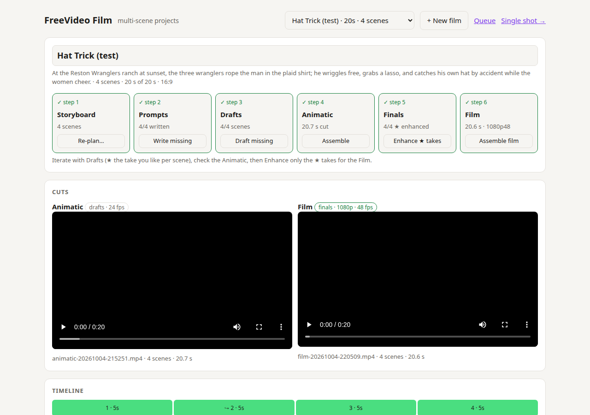

# FreeVideo Director

Turn a rough idea (plus optional pictures) into a MiniMax H3 prompt, then render it on a local
[FreeVideo](https://github.com/FlashML-org/FreeVideo) ComfyUI workspace. It comes as a browser UI,
a CLI, and a multi-scene film editor. Pure Python standard library, no `pip install`.



```
idea + images ──► Director UI :8192 ──► director model (local vision LLM) ──► H3 prompt
                                   └──► ComfyUI :8190 ──► FreeVideo engine ──► video.mp4
```

The director uses the official MiniMax-H3 `h3-prompt-writing` skill (`skill/`, pinned copy) as the
system prompt, and talks to any local OpenAI-compatible **vision** model.

## Requirements

- Python 3.10+ and `ffmpeg` on `PATH`
- A FreeVideo ComfyUI workspace on `127.0.0.1:8190` (needed to render, not to write prompts)
- A director model behind an OpenAI-compatible `/v1/chat/completions` endpoint. The tool uses the
  first of `127.0.0.1:8144` (`qwen3.8-27b`) or `127.0.0.1:8078` (`qwen3.6-35b-a3b`) that answers.
  Pin another with `DIRECTOR_URL` and `DIRECTOR_MODEL`.

## Quick start

```bash
python3 web.py                       # UI at http://127.0.0.1:8192
python3 director.py "a fox runs toward camera at dawn" --seconds 6      # CLI: writes a prompt to out/
```

In the UI: describe the idea, optionally add pictures, click **Write prompt**, edit it, then
**Render**. Use **Draft** for a quick look and **Final** (1080p, 48 fps) for the keeper.

For film projects, open **Film project →** (`/project`). The director storyboards a short film from
a logline, and you draft, pick, and finish scenes step by step:



## Documentation

| | |
|---|---|
| [Usage](docs/usage.md) | Every UI control, film-project steps, all CLI flags, finishing takes, configuration |
| [Configuration](docs/configuration.md) | Every setting: defaults, environment variables, CLI flags, `config.json` |
| [Best practices](docs/best-practices.md) | Writing better prompts, choosing a director model, iterating cheaply, film workflow |
| [Troubleshooting](docs/troubleshooting.md) | Common errors, out-of-memory fixes, playback problems |
| [Evaluating director models](docs/evaluation.md) | The eval harness: case set, fixtures, results schema, comparing models |
| [M6 pilot A/B](docs/pilot.md) | The 12-slot blinded pilot: plan, prompts, renders, blind review, report |
| [Multi-scene design](MULTISCENE-PLAN.md) | Design notes and planned work for film projects |

## Files

| Path | Purpose |
|---|---|
| `director.py` | Prompt writer and CLI |
| `config.py` | Service addresses, paths and defaults (env / flags / `config.json`) |
| `web.py` | Browser UI and job runner (port 8192) |
| `project.py`, `project.html` | Multi-scene film projects (the workspace page; `/project/classic` keeps the old single-column page as `project-classic.html`) |
| `enhance.py` | SeedVR2 upscale, RIFE 48 fps, H.264 encode |
| `h3check.py` | H3 format checks used by the retry loop and `eval.py` |
| `readiness.py` | Prompt / video / finishing health probes behind the header chips |
| `skill/` | Pinned MiniMax-H3 prompt-writing skill |
| `eval/` | Director-model A/B: case set (`eval/cases.json`), fixture README, per-label outputs (`results.json`) |
| `eval/make_fixtures.py` | Deterministic fixture images for the portable eval cases |
| `rescore.py` | Re-score saved `eval/` outputs with today's `h3check.py` (writes `eval/<label>/rescored.json`) |
| `eval_compare.py` | Side-by-side diff of two eval labels, gated on matching validator/case-set versions |
| `pilot.py`, `pilot/scenes.json` | M6 pilot: 3 scenes x 2 seeds x 2 prompt arms, rendered one at a time, blinded review and report |
| `docs/` | Documentation and screenshots |

All servers bind to `127.0.0.1` by default.

## Credits

This tool is glue around other people's work. None of it is bundled except the prompt-writing skill.

- **[FreeVideo](https://github.com/FlashML-org/FreeVideo)** (FlashML): the local video and audio
  generation engine and its ComfyUI node. It runs MiniMax's open
  [H3 model weights](https://huggingface.co/OpenVDN/vdn-minimax-h3-edge) under the MiniMax H3
  Community License, which has territorial and acceptable-use restrictions. Read it before you share anything you generate.
- **[MiniMax-H3](https://github.com/MiniMax-AI/MiniMax-H3):** the `h3-prompt-writing` skill in
  [`skill/`](skill/) is a pinned copy of MiniMax's own, and defines the prompt format the director writes.
- **[ComfyUI](https://github.com/comfy-org/ComfyUI)** runs the render and finishing graphs, with these custom nodes:
  - [ComfyUI-SeedVR2_VideoUpscaler](https://github.com/numz/ComfyUI-SeedVR2_VideoUpscaler) (numz): 1080p upscale
  - [ComfyUI-Frame-Interpolation](https://github.com/Fannovel16/ComfyUI-Frame-Interpolation) (Fannovel16): RIFE 48 fps smoothing
  - [ComfyUI-VideoHelperSuite](https://github.com/Kosinkadink/ComfyUI-VideoHelperSuite) (Kosinkadink): video load and H.264 encode
- **Director models:** [Qwen3.8-27B and Qwen3.6-35B-A3B](https://huggingface.co/Qwen) from the Qwen team
  at Alibaba, served with SGLang and vLLM using the recipes in
  [club-3090](https://github.com/noonghunna/club-3090).
- **[noonghunna](https://github.com/noonghunna)**, who built the club-3090 community and encouraged me to experiment in this space. This project exists because of that support.
- **[FFmpeg](https://ffmpeg.org)** for image scaling, cuts, audio mixing and loudness normalisation.
