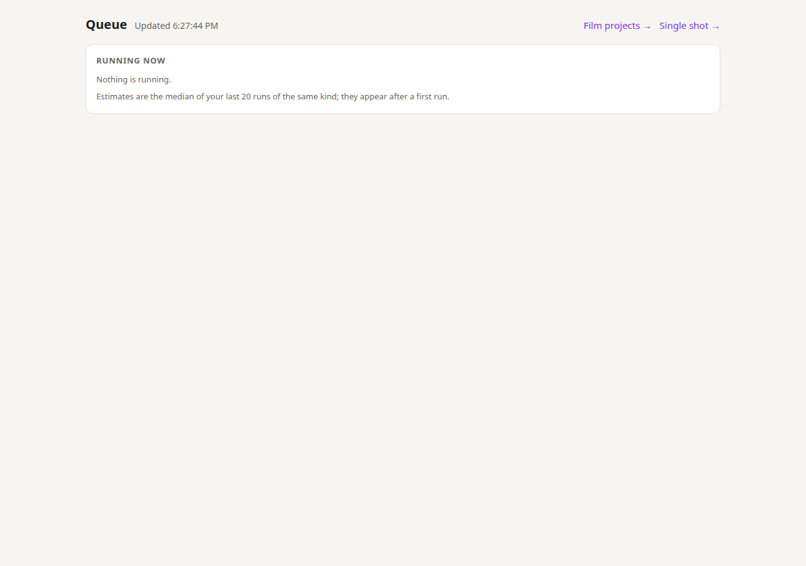

# FreeVideo Director

Turn a rough idea (plus optional pictures) into a MiniMax H3 prompt, then render it on a local
[FreeVideo](https://github.com/FlashML-org/FreeVideo) ComfyUI workspace. It comes as a browser UI,
a CLI, and a multi-scene film editor. Pure Python standard library, no `pip install`.


## How it fits together

```
idea + images ──► Director UI :8192 ──► director model (local vision LLM) ──► H3 prompt
                                   └──► ComfyUI :8190 ──► FreeVideo engine ──► video.mp4
```

The director uses the official MiniMax-H3 `h3-prompt-writing` skill (`skill/`, pinned copy) as the
system prompt. It talks to any local OpenAI-compatible **vision** model.

## Requirements

- Python 3.10+ and `ffmpeg` on `PATH`
- A FreeVideo ComfyUI workspace listening on `127.0.0.1:8190` (needed to render, not to write prompts)
- A director model behind an OpenAI-compatible `/v1/chat/completions` endpoint. By default the
  tool tries these in order and uses the first one that answers:

  | URL | Model name |
  |---|---|
  | `http://127.0.0.1:8144/v1` | `qwen3.8-27b` (best scripts) |
  | `http://127.0.0.1:8078/v1` | `qwen3.6-35b-a3b` (fastest, plainer scripts) |

  Pin any other endpoint with `DIRECTOR_URL` (full chat-completions URL) and `DIRECTOR_MODEL`.

## Usage

### Web UI

```bash
python3 web.py            # http://127.0.0.1:8192   (--host, --port to change)
```

1. **Idea:** describe the scene in plain words, in any language.
2. **Images (optional, up to 2):**
   - **Reference images:** people, objects or places to reuse, labelled `<Picture 1>` / `<Picture 2>` (Ref2VA).
   - **First / last frame:** slot 1 opens the video, slot 2 ends it (I2VA / L2VA / FL2VA).
   - No images means text only (T2VA).
3. **Length:** 4–15 s. Leave **Reasoning** on for better scripts, or turn it off for instant drafts.
4. **Write prompt.** The prompt is saved to `out/`. Edit it freely.
5. **Render** with a preset:
   - **Draft:** fast two-pass render, 1344×768, 24 fps. About 2.5 min for 10 s.
   - **Final:** single-pass render, then upscale to 1080p (SeedVR2), smooth to 48 fps (RIFE), and
     encode (H.264 CRF 16). About 9–10 min for 10 s.
   - **✨ Enhance this take** runs only the finishing stages on a Draft you like, with no re-render.

Live stage progress comes from the ComfyUI websocket, and **Recent takes** lets you enhance an
earlier one. `/queue` shows every job:



### Film projects (multi-scene)

Open **Film project →** (`/project`) to plan, render and cut a short film from several scenes. The
director writes a storyboard, a **style bible** (every character's exact look, the places, the
palette) and a music brief. Then you follow six steps, each highlighted in turn:

| Step | What it does |
|---|---|
| ① Storyboard | 3–8 scenes of 4–15 s that sum to the film length |
| ② Prompts | One H3 prompt per scene, written from the bible |
| ③ Drafts | Draft every scene without a take, each with its own fixed seed |
| ④ Animatic | Cut the ★ takes together to check story and pacing |
| ⑤ Finals | Enhance only the ★ takes (1080p, 48 fps) |
| ⑥ Film | Final cut with a music bed and loudness normalisation (−14 LUFS) |


Scenes are either **Cut** (start from the reference pictures) or **↪ Continue** (start on the exact
last frame of the previous ★ take, so action flows across the cut). Add one music file for the whole
film; it is looped or trimmed, ducked under dialogue, and faded out. Projects live in
`projects/<name>/`. Design notes and next steps are in [MULTISCENE-PLAN.md](MULTISCENE-PLAN.md).

### CLI

```bash
python3 director.py "a fox runs toward camera at dawn" --seconds 6
python3 director.py "the two people on the right have a lightsaber duel" --ref group.jpg
python3 director.py "she turns and walks into the sea" --first start.png --last end.png
```

| Flag | Meaning |
|---|---|
| `--seconds N` | Target length, 4–15 s (default 10) |
| `--ref FILE` | Reference image (Ref2VA), repeatable, up to 4 |
| `--first FILE` / `--last FILE` | First / last frame (I2VA, L2VA, FL2VA) |
| `--no-think` | Skip model reasoning (faster, usually weaker) |
| `--temperature T` | Sampling temperature (default 0.7) |
| `--max-side N` | Downscale images to this long side (default 1024) |
| `--url URL` / `--model NAME` | Use a specific chat-completions endpoint |
| `--out FILE` | Write the prompt here (default `out/<timestamp>.txt`) |

### Finishing a take from the command line

```bash
python3 enhance.py <run dir or its video.mp4>    # --resolution 1080 --fps-multiplier 2 --crf 16
```

Enhance works from the take's raw decoded frames (`video.artifacts/rgb.npy` + `audio.wav`), not its
compressed MP4. It needs the SeedVR2 and RIFE nodes and models installed in the ComfyUI workspace.

## Files

| Path | Purpose |
|---|---|
| `director.py` | Prompt writer and CLI |
| `web.py` | Browser UI and job runner (port 8192) |
| `project.py`, `project.html` | Multi-scene film projects |
| `enhance.py` | SeedVR2 upscale, RIFE 48 fps, H.264 encode |
| `h3check.py` | Checks a prompt against the H3 format |
| `skill/` | Pinned MiniMax-H3 prompt-writing skill |
| `eval/` | Director-model A/B outputs (Qwen3.6-35B vs Qwen3.8-27B) |
| `docs/` | README screenshots |

All servers bind to `127.0.0.1` by default.
